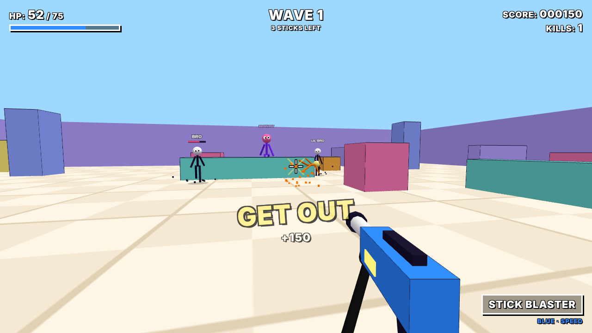
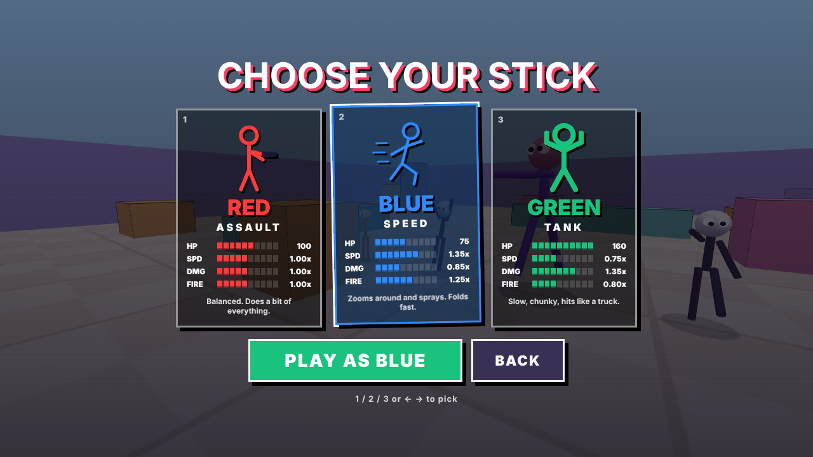

# Stick Arena

**A fast, arcade first-person shooter that runs in the browser.** You're a
stickman with a blaster; waves of googly-eyed stickmen named GOOBER, SKIBIDI
and GIGACHAD want to bonk you. Survive. Get kills. Don't get cooked.



> **Play it in your browser:** a live build is published to GitHub Pages on
> every push to `main`. Look for the link in the **About** panel of this
> repository. Desktop browser with a mouse and keyboard required.

---

## At a glance

| | |
| --- | --- |
| **What** | A complete, playable first-person shooter: menus, 3 playable characters with different stats, 3 enemy types with pathfinding AI, endless scaling waves, scoring, game over and restart. |
| **Stack** | JavaScript (ES modules), [Three.js](https://threejs.org/) for WebGL rendering, [Vite](https://vitejs.dev/) for dev server and build, [Playwright](https://playwright.dev/) for end-to-end tests, GitHub Actions for CI and deploys. |
| **Size** | About 2,600 lines across 15 focused JavaScript modules and one stylesheet. One runtime dependency (Three.js). Zero asset files. |
| **Quality gates** | A 25-check end-to-end test that plays the whole game loop in headless Chromium and fails on any console error, run in CI on every push and gating the deploy. |
| **Status** | Personal portfolio project. Feature-complete V1, not a commercial product. |

## Engineering highlights

The parts worth looking at if you're reviewing the code:

- **Tests that measure behaviour, not just presence.** The smoke test
  ([`tests/smoke.mjs`](tests/smoke.mjs)) doesn't stop at "the BLUE card says
  1.35x speed". It runs the real `Player.update()` and `Weapon.update()` for a
  fixed simulated second and asserts that BLUE actually covers 1.35x the
  distance and fires more shots than RED. Waves 1–5 run as a logic-only
  simulation (no rendering), so the test is fast and deterministic.
- **A bug the tests found that a playtest likely wouldn't.** Repeated runs
  were intermittently flaky. Instrumenting raw `mousemove` events showed
  Chromium can deliver a huge cursor-jump delta while the pointer is being
  captured, sometimes *before* `pointerlockchange` fires, snapping the view
  sideways. Rather than retry until green, the input layer now reads the lock
  state directly, drops the first captured move and discards impossible
  single-event deltas ([`src/input.js`](src/input.js)).
- **Pathfinding sized to the problem.** Enemies walk straight at you when the
  line is clear; otherwise they follow a *flow field*: one breadth-first search
  over a 1 m grid, re-run only when the player enters a new cell, shared by
  every enemy ([`src/navgrid.js`](src/navgrid.js)). Constant cost per enemy
  per frame, no per-enemy A*, no getting stuck on crates.
- **Cheap, explicit collision.** Every solid object is an axis-aligned box:
  circle-vs-box push-out for movement and slab ray tests for bullets and line
  of sight ([`src/arena.js`](src/arena.js)). Hit detection is analytic:
  ray-vs-sphere for heads (double damage) and ray-vs-cylinder for bodies.
- **No allocation in the hot path.** Particles and tracers come from fixed
  pools that are reused in place ([`src/effects.js`](src/effects.js)). The
  HUD writes to the DOM only when a value changes.
- **Zero asset pipeline.** Every model is primitive geometry, every texture is
  drawn on a `<canvas>` at startup, and every sound is synthesised with the
  Web Audio API ([`src/audio.js`](src/audio.js)). Nothing to download, license
  or keep in sync.
- **A weapon that never clips through walls.** The first-person gun is drawn
  in a second render pass with its own camera after clearing the depth buffer
  ([`src/weapon.js`](src/weapon.js)), the standard viewmodel technique.
- **Dependency hygiene.** One runtime dependency. `npm audit` is clean; the
  Vite floor is pinned above a dev-server security advisory.
- **Explicit state machine.** `menu → playing ⇄ paused → dying → gameover →
  playing`, all in one place ([`src/game.js`](src/game.js)). Losing pointer
  lock or switching tabs pauses the game rather than letting you die
  alt-tabbed.

## Run it yourself

The game is a static website: there's no backend, no database, no
environment variables and no API keys.

### Prerequisites

- **Node.js 20.19+ or 22.12+** (Vite's minimum). [Download](https://nodejs.org) or `nvm install 22`.
- **npm** (ships with Node).
- **A desktop browser with WebGL 2**: current Chrome, Edge, Firefox or Safari.
- A **mouse and keyboard**. There are no touch controls.

### 1. Install

```bash
git clone https://github.com/<your-username>/stick-arena.git
cd stick-arena
npm ci
```

`npm ci` installs the exact locked versions. `npm install` works too.

### 2. Check your setup

```bash
npm run doctor            # checks Node, npm, dependencies and the test browser
npm run doctor -- --build # also does a real production build
```

Each failed check prints the command that fixes it. A warning about Chromium
only matters for running the tests.

### 3. Play

```bash
npm run dev
```

Open the URL Vite prints (normally http://localhost:5173), press **PLAY**, pick
a stick and press **PLAY AS …**. Clicking captures the mouse; **Esc** frees
it and pauses.

### 4. Build a static copy

```bash
npm run build     # writes dist/
npm run preview   # serves dist/ at http://localhost:4173 to check it
```

`dist/` uses relative paths, so it works from any folder or sub-path: GitHub
Pages, Netlify, itch.io, or any static file host.

### 5. Run the tests

```bash
npx playwright install chromium   # once: downloads the headless browser
npm test                          # against the dev server
npm run test:dist                 # builds, then tests the production bundle
```

Expect `26/26 passed` (the 25 checks plus "no console errors"). The tests use
software WebGL, so they run on machines without a GPU, including CI.

### 6. Publish your own copy (optional)

[`.github/workflows/ci.yml`](.github/workflows/ci.yml) tests every push and
deploys `main` to GitHub Pages. To use it on your fork:

1. Make the repository **public** (Pages isn't available for private repos on
   free plans; the deploy job skips itself until then).
2. **Settings → Pages → Build and deployment → Source: GitHub Actions.**
3. Push to `main`, or open **Actions → CI → Run workflow**.

### Troubleshooting

| Problem | Fix |
| --- | --- |
| `npm run doctor` says Node is too old | Install Node 22 LTS. |
| Port 5173 already in use | Vite picks the next free port; use the URL it prints. |
| The mouse isn't captured | Click inside the game. After pressing Esc, browsers block re-capture for about a second. |
| Black screen | WebGL is disabled or unavailable; enable hardware acceleration in your browser settings. |
| Tests fail to launch a browser | `npx playwright install chromium` (on Linux CI add `--with-deps`). |

## How to play

| Key | Action |
| --- | --- |
| `W` `A` `S` `D` | Move |
| Mouse | Aim |
| Left click | Shoot (hold for auto) |
| `Esc` | Release the mouse / pause |
| `M` | Mute |

Mouse sensitivity is on the pause and How To Play screens.



| Stick | Role | Health | Speed | Damage | Fire rate |
| --- | --- | --- | --- | --- | --- |
| **RED** | Assault | 100 | 1.00x | 1.00x | 1.00x |
| **BLUE** | Speed | 75 | 1.35x | 0.85x | 1.25x |
| **GREEN** | Tank | 160 | 0.75x | 1.35x | 0.80x |

| Enemy | Health | Speed | Hit | Points |
| --- | --- | --- | --- | --- |
| Normal stick | 65 | 3.6 m/s | 10 | 100 |
| Fast stick | 40 | 6.4 m/s | 6 | 150 |
| Big stick | 240 | 2.4 m/s | 24 | 300 |

Enemies raise their arms and their heads glow red before they swing: step
back to make them miss. Headshots do double damage. Waves are 3, 5, 7 and 10
sticks, then grow by 3–4 per wave, with +12% enemy health and +4% speed each
wave (speed capped at +45%) and more fast and big sticks. Clearing a wave
heals 20 HP.

## Project structure

```
src/
  main.js        boot: creates the Game and the UI
  game.js        state machine, main loop, shooting, scoring
  input.js       keyboard, mouse, pointer lock
  player.js      movement, camera, collision, death camera
  characters.js  RED / BLUE / GREEN stats
  weapon.js      the blaster: viewmodel pass, fire rate, recoil, muzzle flash
  enemy.js       enemy types, stickman model, AI, hits, death, animation
  navgrid.js     flow-field pathfinding
  waves.js       wave sizes, composition and difficulty scaling
  arena.js       arena layout, colliders, ray casts
  effects.js     pooled particles and tracers
  hud.js         in-game HUD, kill messages, announcements
  ui.js          menus, character select, pause, game over
  brainrot.js    enemy names and kill lines
  audio.js       synthesised sound effects
  style.css      all styling
scripts/doctor.mjs   setup checker (npm run doctor)
tests/smoke.mjs      end-to-end test (npm test)
```

## Known limitations

- Desktop only; there are no touch controls.
- One arena and one weapon.
- An enemy launched by a kill can briefly fly through a wall before it pops.
- Performance hasn't been profiled on low-end hardware. The design (pooled
  effects, one shared pathfinding search, about 125 draw calls measured with
  a full wave on screen) targets 60 FPS on an ordinary laptop.

## How it was built

I wrote the specification: features, character and enemy stats, the
development phases and the acceptance criteria. The code was written with an
AI coding agent (Claude Code) working from that spec. Each phase was checked
in a headless browser before moving on, and the test suite holds the result
to the spec.

## License

[MIT](LICENSE)
